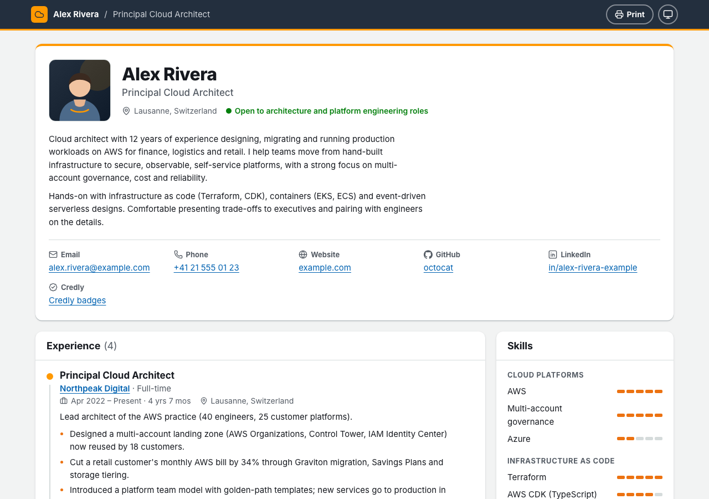
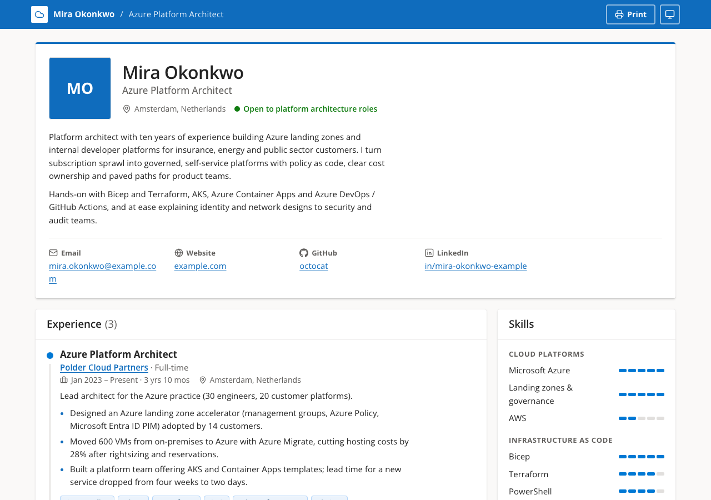
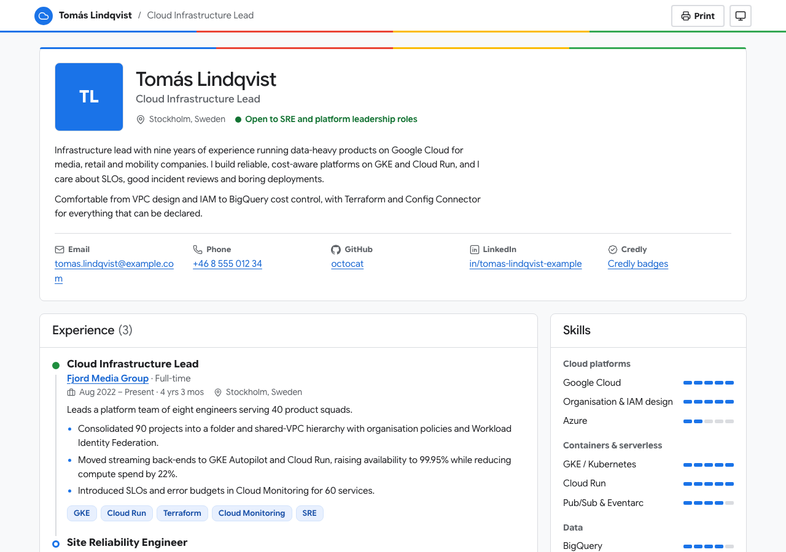
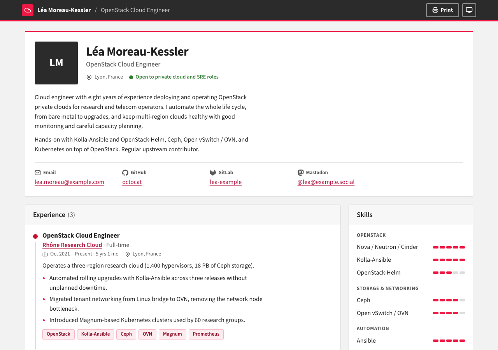
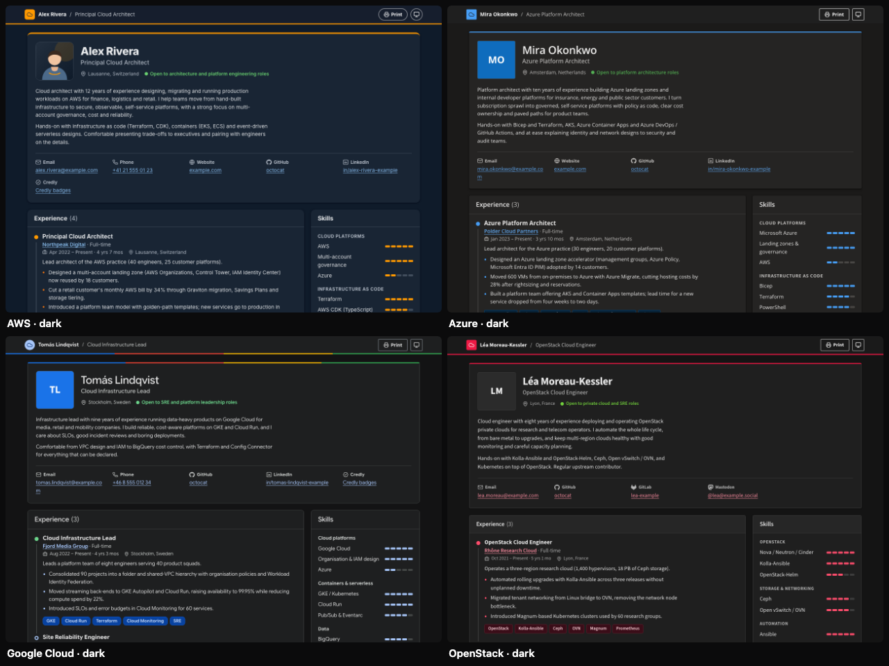
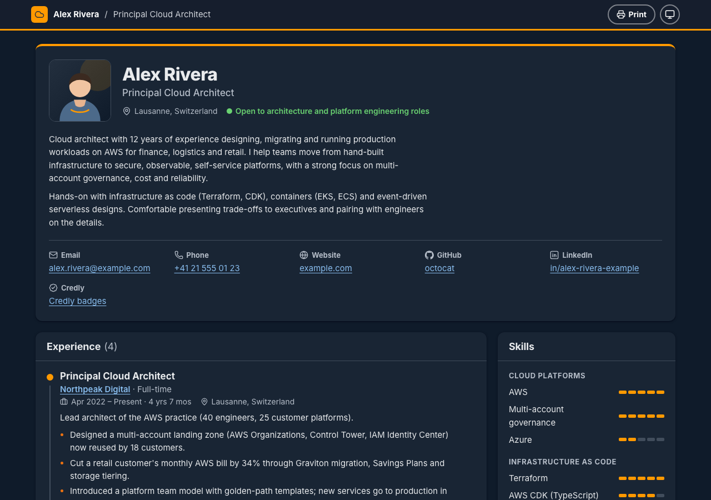
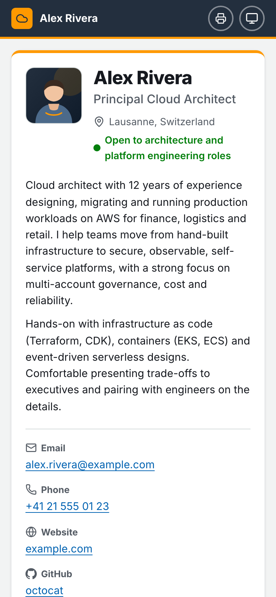
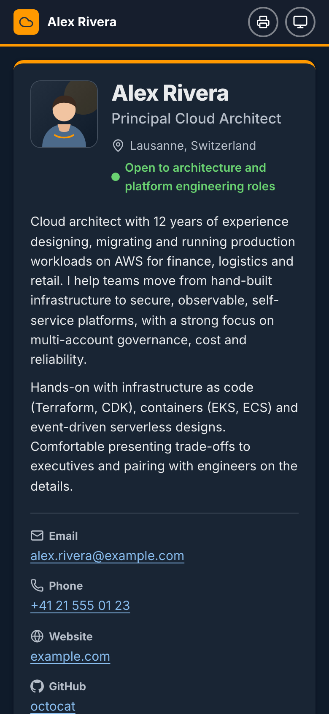
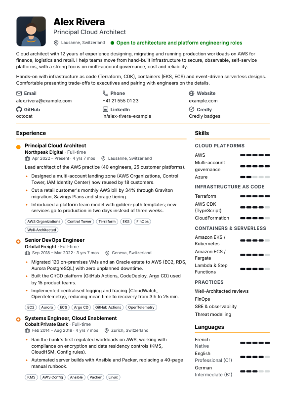

# cloud-resume

A modern, data-driven resume / CV theme for cloud engineers, in the style of the
**AWS, Azure, Google Cloud or OpenStack** consoles. Edit one YAML file, pick a style,
push, and GitHub Pages publishes your resume.

**Live demo:** [AWS](https://kallioli.github.io/cloud-resume/) ·
[Azure](https://kallioli.github.io/cloud-resume/azure/) ·
[Google Cloud](https://kallioli.github.io/cloud-resume/gcp/) ·
[OpenStack](https://kallioli.github.io/cloud-resume/openstack/)

> **Formerly `aws-resume`.** The repository was renamed to `cloud-resume` when the
> Azure, Google Cloud and OpenStack styles were added. Git URLs and links to the old
> repository redirect automatically, but the old demo address
> `kallioli.github.io/aws-resume/` no longer works: use the links above.
> Existing sites keep the AWS style and build unchanged.

- One data file (`src/data/resume.yaml`), validated at build time with clear error messages
- Four styles (`aws`, `azure`, `gcp`, `openstack`) from one codebase: one setting changes colours, font and console details
- Light and dark mode (follows the OS, with a toggle that remembers the choice)
- Phone-first responsive layout, semantic HTML, WCAG AA contrast, keyboard friendly
- Print stylesheet: "Print → Save as PDF" gives a clean two-page A4 resume
- SEO ready: meta tags, Open Graph, JSON-LD `Person` structured data
- No tracking by default, no client-side framework: about 1 KB of inline JS for the theme toggle and print button
- Interface in English or French (easy to add more languages)
- Built with [Astro](https://astro.build) and TypeScript; deploys with the official GitHub Pages actions

| AWS | Azure |
| --- | --- |
|  |  |
| **Google Cloud** | **OpenStack** |
|  |  |

<details>
<summary>Dark mode (all styles), mobile and print</summary>



| Light | Dark |
| --- | --- |
|  |  |

| Mobile (light) | Mobile (dark) | Print / PDF (page 1) |
| --- | --- | --- |
|  |  |  |

</details>

> **Coming from the 2017 Jekyll version?** It is kept unchanged on the
> [`legacy/jekyll`](https://github.com/kallioli/cloud-resume/tree/legacy/jekyll) branch.
> Version 2 is a full rewrite: the data format changed, so existing forks should copy
> their content into the new `resume.yaml` rather than merge.

## Quick start

1. Click **Use this template** (or **Fork**) at the top of this page and name the repository,
   for example `cloud-resume` or `<your-user>.github.io`.
2. In your new repository open **Settings → Pages** and set **Source** to **GitHub Actions**.
3. Edit [`src/data/resume.yaml`](src/data/resume.yaml) on GitHub (pencil icon) and commit.
   Optionally pick a style with `brand` in [`src/config.ts`](src/config.ts) (see [Styles](#styles-aws-azure-google-cloud-openstack)).
4. The **Deploy to GitHub Pages** workflow builds and publishes the site.
   It appears at `https://<your-user>.github.io/<repository>/` after a minute.

The workflow detects the right URL (project site, user site or custom domain) by itself,
so no configuration is needed for GitHub Pages.

### Run it locally

Requires Node.js 22.23 or newer (the version used in CI is in `.nvmrc`).

```sh
npm ci
npm run dev       # http://localhost:4321/cloud-resume/ with live reload
npm run check     # type-check the project and the templates
npm run build     # static site in dist/
npm run preview   # serve dist/ locally

BRAND=gcp npm run dev                                      # try another style
BRAND=azure RESUME_DATA=src/data/examples/azure.yaml npm run dev   # with its example data
npm run build:demo   # the public demo: every style with its example, in dist/
```

## Styles (AWS, Azure, Google Cloud, OpenStack)

The same page, markup and data come in four styles. A style changes the colour
palette (light and dark), the font and a few console details: top bar, card corners
and shadows, section headers, accent rules, buttons and chips.

| `brand` | Palette | Font (self-hosted, SIL OFL) | Console details |
| --- | --- | --- | --- |
| `aws` (default) | Squid ink `#232F3E`, orange `#FF9900` | [Inter](https://rsms.me/inter/) | Dark bar with orange rule, rounded cards, pill buttons |
| `azure` | Azure blue `#0078D4` / `#0F6CBD`, Fluent neutrals | [Open Sans](https://fonts.google.com/specimen/Open+Sans) (close to Segoe UI) | Blue bar, 4 px corners, Fluent depth shadows, semibold headers |
| `gcp` | Google blue `#1A73E8`, red / yellow / green accents, Material neutrals | [Google Sans Flex](https://fonts.google.com/specimen/Google+Sans+Flex) | White bar with a four-colour stripe, outlined 8 px cards, no shadows |
| `openstack` | OpenStack red `#ED1944`, dark grey and neutral panels | [Source Sans 3](https://fonts.google.com/specimen/Source+Sans+3) | Dark bar with red rule, Horizon-like panels with grey headers |

**Pick a style** in `src/config.ts`:

```ts
const config: ThemeConfig = {
  brand: 'azure',               // 'aws' | 'azure' | 'gcp' | 'openstack'
  data: 'src/data/resume.yaml', // your data file
  // ...
};
```

Only the font of the selected style is bundled. For a one-off build, the environment
variables `BRAND` and `RESUME_DATA` override both settings. Every style has a fictional
example in [`src/data/examples/`](src/data/examples) (`aws.yaml`, `azure.yaml`, `gcp.yaml`,
`openstack.yaml`) with current certification names and badge images (hot-linked from
Credly, except the Microsoft Learn badges, which are copied under `public/brands/azure/`); copy
the one you like over `src/data/resume.yaml` as a starting point. Without an `issuer`,
certifications default to the vendor of the style (Amazon Web Services, Microsoft,
Google Cloud, OpenInfra Foundation).

All four styles meet WCAG AA contrast in light and dark mode, and print as a clean light
A4 resume. The header icon, favicon and placeholder badge are a generic cloud glyph:
the styles use colours only, no logos.

> **Trademarks.** AWS, Microsoft Azure, Google Cloud and OpenStack are trademarks of
> their respective owners (Amazon.com, Inc. or its affiliates, Microsoft Corporation,
> Google LLC, the OpenInfra Foundation). The styles only evoke the colours of their
> consoles. This project is not affiliated with, sponsored or endorsed by Amazon,
> Microsoft, Google or the OpenInfra Foundation, and includes none of their logos or
> badge artwork.

## Data file reference

Everything shown on the page comes from `src/data/resume.yaml`. Only `basics.name` and
`basics.title` are required; **every other section can be removed** and simply disappears
from the page.

- Dates are strings `"YYYY"`, `"YYYY-MM"` or `"YYYY-MM-DD"` (keep the quotes).
- Images (`photo`, `badge`) are either an absolute `https://` URL or the name of a file you
  put in `public/` (for example `photo: me.jpg` for `public/me.jpg`).
- Unknown keys are rejected, so typos are caught. A mistake stops the build with its exact location:

  ```text
  src/data/resume.yaml does not match the expected format:
    - experiences.0.start: Expected a date as YYYY, YYYY-MM or YYYY-MM-DD (quote it in YAML, e.g. "2024-03")
    - experiences.0: Unrecognized key: "hightlights"
  ```

- Editors with the YAML language server (VS Code + the *YAML* extension, JetBrains IDEs)
  get autocompletion from `src/data/resume.schema.json`. Regenerate it with `npm run schema`
  if you change `src/lib/schema.ts`.

### `basics` (required)

| Key | Type | Notes |
| --- | --- | --- |
| `name` | string | **Required.** |
| `title` | string | **Required.** Job title under the name. |
| `summary` | string | Paragraphs separated by a blank line (use `|` in YAML). |
| `photo` | URL or file | Square image. Omit to show initials. |
| `photoAlt` | string | Alternative text. Defaults to the name. |
| `location` | string | e.g. `Lausanne, Switzerland` |
| `availability` | string | Status line shown with a green dot, e.g. `Open to new roles`. |
| `email`, `phone` | string | Rendered as `mailto:` / `tel:` links. |
| `website` | URL | |
| `profiles` | list | `network` (`github`, `gitlab`, `linkedin`, `x`, `mastodon`, `bluesky`, `credly`, `website`, `blog`, `other`), `url`, optional `label`. |

### `experiences`

| Key | Type | Notes |
| --- | --- | --- |
| `company`, `role`, `start` | string / date | **Required.** |
| `end` | date | Omit for the current position ("Present"). Duration is computed. |
| `companyUrl` | URL | |
| `location`, `type` | string | `type` e.g. `Full-time`, `Contract`. |
| `summary` | string | One-line description. |
| `highlights` | list of strings | Achievements, shown as bullets. |
| `tags` | list of strings | Technologies, shown as chips. |

### `certifications`

| Key | Type | Notes |
| --- | --- | --- |
| `name`, `issued` | string / date | **Required.** |
| `issuer` | string | Defaults to the vendor of the style: `Amazon Web Services` (`aws`), `Microsoft`, `Google Cloud`, `OpenInfra Foundation`. |
| `expires` | date | Omit if it does not expire. Expired certifications are greyed out and listed last. |
| `credentialId` | string | |
| `url` | URL | Public verification page (Credly, issuer portal). |
| `badge` | URL or file | Badge image. Omit to use the generic placeholder. |

Vendor badge artwork is trademarked and is **not** included in this repository.
To show your official badge, open your badge on [Credly](https://www.credly.com) (AWS,
Google Cloud, Linux Foundation, ...) or your Microsoft Learn profile, copy the image
address and paste it as `badge`. The example data does this with the public badge images.

AWS renamed *SysOps Administrator – Associate* to **CloudOps Engineer – Associate** with the
SOA-C03 exam (September 2025). Use the name printed on your own certificate.

### `projects`

`name` and `description` (required), `url`, `repo`, `tags`.

### `education`

`institution` and `degree` (required), `field`, `url`, `location`, `start`, `end`, `details`.

### `skills`

A list of groups, each with a `name` and `items`. An item is either a plain string or
`{ name, level }` where `level` is an integer from 1 to 5 (shown as a meter).

```yaml
skills:
  - name: Infrastructure as code
    items:
      - { name: Terraform, level: 5 }
      - CloudFormation          # no meter
```

### `languages`

`name` (required), `fluency` (free text such as `Native` or `C1`), `level` (1–5).

### `interests`

A list of strings, or `{ name, url }` objects.

## Customisation

### Theme settings — `src/config.ts`

| Setting | Default | Description |
| --- | --- | --- |
| `brand` | `'aws'` | Style: `'aws'`, `'azure'`, `'gcp'` or `'openstack'`. Env override: `BRAND`. |
| `data` | `'src/data/resume.yaml'` | Data file, relative to the project root. Env override: `RESUME_DATA`. |
| `lang` | `'en'` | Interface language and date format: `'en'` or `'fr'`. |
| `defaultTheme` | `'system'` | `'system'`, `'light'` or `'dark'` before the visitor uses the toggle. |
| `sections` | experiences, certifications, projects, education | Order of the main column. Remove an id to hide the section. |
| `sidebar` | skills, languages, interests | Order of the side column. |
| `pdf` | `null` | Path of a PDF in `public/` (e.g. `'resume.pdf'`) or a URL. Shows a **Download PDF** button. |
| `printButton` | `true` | Shows a **Print** button. |
| `description` | summary | Meta description for search engines. |
| `ogImage` | – | Social preview image (1200×630) in `public/` or a URL. |
| `analytics` | `null` | Optional analytics script, see below. |

### Colours, font and shape — `src/styles/global.css`

All colours and console details are CSS custom properties at the top of the file. The
AWS style uses `:root` (light) and the `prefers-color-scheme: dark` and `[data-theme='dark']`
blocks (keep those two identical). Each other style overrides the same tokens in one
`:root[data-brand='…']` block, with `light-dark(light, dark)` pairs. Every text colour
meets WCAG AA contrast in both modes. `--radius` controls the card corners.

Fonts are self-hosted through `@fontsource` packages, so no request goes to a third-party
font CDN. The package of each style is set in `src/brands.ts` (`font`) and its family in
`--font-sans`; to use another font, install its `@fontsource` package and change both.

### Interface labels and new languages — `src/i18n/ui.ts`

All the words the theme adds (section titles, "Present", "Verify", ...) are in this file.
To add a language, copy the `en` block under a new key (e.g. `de`), translate it, and set
`lang: 'de'` in `src/config.ts`. TypeScript flags any missing label.

### Sections and layout

Each section is a small component in `src/components/`. The page itself is
`src/pages/index.astro`; the HTML shell, top bar and meta tags are in `src/layouts/Base.astro`.

### Analytics (optional, off by default)

Nothing is tracked unless you enable it. To use a privacy-friendly, cookie-less service,
set `analytics` in `src/config.ts`; the theme adds a single deferred script tag:

```ts
// Plausible
analytics: { src: 'https://plausible.io/js/script.js', attributes: { 'data-domain': 'cv.example.com' } },
// Umami
analytics: { src: 'https://cloud.umami.is/script.js', attributes: { 'data-website-id': '<your-id>' } },
// GoatCounter
analytics: { src: 'https://gc.zgo.at/count.js', attributes: { 'data-goatcounter': 'https://<code>.goatcounter.com/count' } },
```

### PDF version

Open the site and use **Print** (or Ctrl/Cmd + P), choose **Save as PDF**, and enable
*Background graphics* for the badge colours. The print stylesheet hides the toolbar,
switches to a light, compact two-column layout and avoids splitting entries across pages.
To offer a ready-made file instead, put it in `public/` and set `pdf` in `src/config.ts`.

## Deployment

### GitHub Pages (recommended)

`.github/workflows/deploy.yml` runs on every push to `master`/`main`: it installs the
dependencies, builds with the URL reported by `actions/configure-pages`, and publishes with
`actions/upload-pages-artifact` + `actions/deploy-pages`. The only manual step is
**Settings → Pages → Source: GitHub Actions**. The workflow does not change that setting.

In the theme's own repository (`kallioli/cloud-resume`) the workflow runs
`npm run build:demo` instead, which publishes the four styles with their example data
(`/`, `/azure/`, `/gcp/`, `/openstack/`) and adds a small "Other styles" link list in the
footer (`DEMO_LINKS=true`). Forks and copies always build their own resume, without it.

`.github/workflows/ci.yml` type-checks every pull request, builds the default site and
builds all four styles. Dependabot opens
weekly update PRs for npm packages and GitHub Actions (`.github/dependabot.yml`).

### Custom domain

Add the domain in **Settings → Pages → Custom domain**. The deploy workflow then builds
for the domain root automatically. For a build outside GitHub Actions, set the URL yourself:

```sh
SITE=https://cv.example.com BASE_PATH=/ npm run build
```

The defaults (used when these variables are not set) are at the top of `astro.config.mjs`.

### Other hosts

`npm run build` produces a fully static site in `dist/` that any static host
(Netlify, Cloudflare Pages, S3 + CloudFront, ...) can serve. Set `SITE` and `BASE_PATH`
as above.

## Project structure

```text
src/
  data/resume.yaml          your content (the only file most people edit)
  data/examples/            example content for each style
  data/resume.schema.json   JSON Schema for editor autocompletion (generated)
  config.ts                 theme settings (style, data file, language, sections, PDF, analytics)
  brands.ts                 the styles: name, default issuer, font, favicon
  i18n/ui.ts                interface labels (en, fr)
  lib/schema.ts             zod schema of the data file
  lib/resume.ts             loads and validates the data file
  components/               one component per section
  layouts/Base.astro        HTML shell, meta tags, top bar, theme toggle
  pages/index.astro         the resume page
  styles/global.css         design tokens, styles, layout, dark mode, print
public/                     favicon, example avatar, placeholder badge, your files
public/brands/              favicon and placeholder badge of the other styles
scripts/                    JSON Schema generator, demo build
```

## Credits

- Original layout: [online-cv](https://github.com/webjeda/online-cv) Jekyll theme by
  [webjeda](https://github.com/webjeda) (MIT). The 2017 version of this project was derived from it.
- Icons: [Lucide](https://lucide.dev) (ISC) and [Simple Icons](https://simpleicons.org) (CC0).
- Fonts (SIL Open Font License 1.1): [Inter](https://rsms.me/inter/) by Rasmus Andersson,
  Open Sans, Google Sans Flex and Source Sans 3, via [Fontsource](https://fontsource.org).
- AWS, Microsoft Azure, Google Cloud and OpenStack, their logos and certification badges
  are trademarks of Amazon.com, Inc. or its affiliates, Microsoft Corporation, Google LLC
  and the OpenInfra Foundation. This project is not affiliated with or endorsed by any of them.

## Licence

[MIT](LICENSE) — Copyright (c) 2016 webjeda, Copyright (c) 2017-2026 Kevin Allioli.
